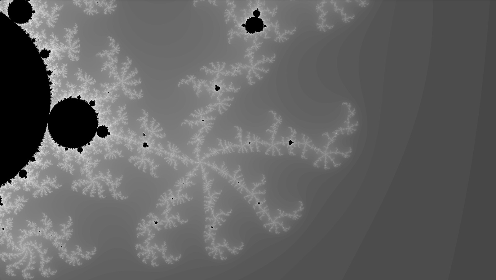

# Fractal Renderer

A small C++ application for rendering fractals with SDL2.

Right now only the **Mandelbrot set** is implemented. I plan to add other fractals once the renderer is multithreaded.

The project started because I wanted a new wallpaper. That's how I ended up looking at fractals, which are (IMO) very interesting figures.

<p align="center">
  
</p>

---

## Structure

```
.
├── src/          # Fractal renderer + SDL2 window/display code
│   ├── fractal.{h,cpp}
│   └── window.{h,cpp}
├── tests/        # Entry point (for the moment) (main.cpp) used to run the renderer
├── docs/imgs/    # Screenshots
└── nix/          # Nix flake for a reproducible dev shell
```

## Requirements

| Dependency   | Version |
|--------------|---------|
| CMake        | ≥ 3.26  |
| C++ compiler | C++17 or newer |
| SDL2         | 2.x     |

### Packages
If not in debian based distros, install the equivalent of these packages.
```sh
sudo apt install build-essential cmake pkg-config libsdl2-dev
```

### Nix

If you use Nix, the flake in `nix/` is a convenient way to get everything (CMake, Ninja, SDL2, gdb, valgrind) in one command:

```sh
nix develop ./nix
```

It's just a convenience, though. Feel free to set up your environment however you like.

## Build

From the repository root:

```sh
cmake -B build          # configure the project and create the build directory
cmake --build build     # compile
```

## Run

```sh
./build/fractal_tests
```

> I plan to add command-line arguments for changing the window resolution and choosing between fractal types.

## Roadmap

- [ ] **Parallel rendering**: add a thread pool so each frame renders much faster.
- [ ] **Colours**: the output is grayscale for now. Add smoother lighting and different colour palettes.
- [ ] **More fractals**: Julia set, Burning Ship, …
- [ ] **CLI arguments**: resolution and fractal type.

---

<sub>I built this whole project in one afternoon, but I tried to make sensible design choices where I could (and where I knew better), like using `float` instead of `double`. There's always room to improve!</sub>
